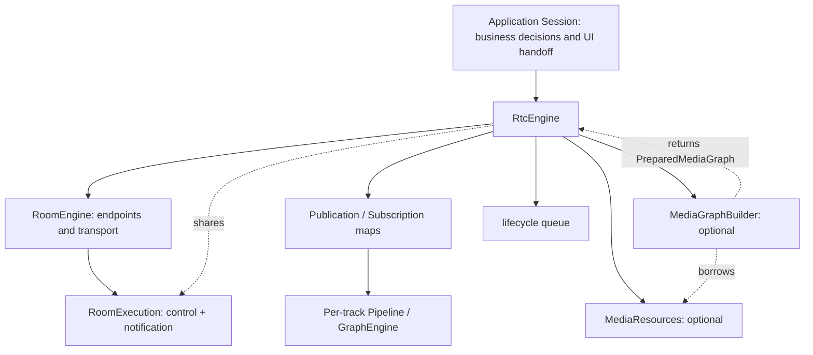

# Current SDK architecture

Source-aligned on 2026-11-02. Current entry points and examples are in
[the media API guide](rtc-media-engine.md); dated refactor reports describe their
recorded revisions, not additional guarantees of this implementation.

The public configuration API is `rtc/engine.hpp`. It does not include GraphFlow,
WebRTC or FFmpeg headers. `rtc/graph_api.hpp` is an explicit advanced extension:
`engine.graph().publish_graph(...)` and `engine.graph().subscribe(...)` share the
same publication/subscription maps and lifecycle as ordinary media operations.

## Ownership and dependencies

`RtcEngine` directly owns its state (no PImpl), one RoomEngine, a lifecycle
queue, publication/subscription maps, an optional MediaGraphBuilder and optional
MediaResources. RoomEngine owns RoomExecution (control and notification queues),
which RtcEngine shares. There is no separate TrackGraphRegistry,
RtcPipelineEngine or RtcMediaEngine class in this path. RTCMediaEngine is a CMake
target combining the facade with media assembly.

RoomEngine owns transport state and encoded endpoints, never media graphs or
devices. It is also public through `rtc/room_engine.hpp` and
`create_livekit_room()` for callers that need encoded endpoints without graphs.
RtcMediaGraphBuilder borrows RtcMediaResources and returns a PreparedMediaGraph;
RtcEngine creates and starts each PublishPipeline / SubscribePipeline. Each
pipeline owns a GraphEngine. Removing one track does not close the room.

The facade coordinates endpoint creation, graph startup and rollback. Ordinary
applications choose sources, subscriptions, output callbacks and business error
handling; they do not construct GraphNodes or manage endpoint/graph teardown.
Current MediaPublishSpec still requires codec/clock/channel configuration through
TrackDescriptor. Typed sources, independent preview and separate business versus
graph diagnostic snapshots are potential API improvements, not existing facade
features. See [current API boundaries](rtc-media-engine.md#客户端边界与当前限制).

`RTCNodeApi` supplies common node contracts and GraphFlow core. Codec, capture and
output targets depend on it, not RTCEngine. RTCMediaEngine links these lower-layer
targets with RTCEngine. Node consumers constructing graphs must explicitly link
GraphFlow engine; applications using the facade link RTCMediaEngine.

## Execution

RtcEngine and its internal RoomEngine share exactly three TaskQueue workers:

| Worker | Responsibility |
| --- | --- |
| control | Room state, transport requests/events, encoded endpoint send/receive |
| lifecycle | Graph construction, startup, shutdown and media resource ownership |
| notification | Public operation completions and continuous Observer notifications |

Join, publication/subscription and track/member controls enqueue work on their
owning queues. Native success arrives asynchronously; facade publication/
subscription completions follow graph startup. Snapshot queries, media assembly,
shared-input creation, Observer replacement and leave have synchronous paths.
Public controls remain void and accept per-call Completion<T> callbacks.
Continuous state events use RoomObserver / RtcObserver. Data writes use the existing pipeline and bounded endpoint queues.

The execution adapter only provides FIFO post, synchronous invoke and drain.
Only pending callbacks and existing binding/control IDs are retained; there is no
RTC deadline scheduler, reserved terminal slot,
extra media sender worker or graph recovery state machine. Existing backend and
media-library workers and their own error/queue handling remain unchanged.

Control does not synchronously wait for lifecycle or application callbacks.
However, RoomEngine completions and events (including continuations into
RtcEngine) pass through notification before posting to lifecycle. Slow public
callbacks can therefore delay internal continuations and teardown. Application
callbacks may submit requests but must not wait for other callbacks or synchronously leave.
Graph factories and lifecycle hooks must not wait for notification callbacks.
The external owner stops application callers before leave/destruction. leave
stops graphs, stops transport, then drains lifecycle and notification work; close
is an alias for leave and permits an explicit subsequent join. A supplied leave
completion runs on notification and has been delivered when a valid owner-thread
leave call returns. Observer removal does not cancel pending completions.

Graph construction/start failures are translated into Result and trigger endpoint
rollback. Runtime graph observations are not a general automatic recovery loop:
RtcEngine does not install a graph-stopped callback that scans/rebuilds failed
graphs. Applications should inspect MediaTrack status and explicitly remove failed
tracks or leave. Backend track events and media graph failure observations must
not be assumed to be identical notification channels. RoomServices retains its
own future-based operations and service executors.

See [three-thread historical baseline](rtc-hardening-20261031.md) and
[public callback usage](rtc-simple-observer.md).

## Frame ownership and timing

`media::FrameView` is the common immutable CPU view for RTC and Player. Its owner
keeps all plane spans alive; format, stride, sample rate, channel count and clock
rate are explicit. RTC `MediaOutput::frame` delivers this view. Player frames
convert with `media::frame_view`. Adapters retain storage without copying;
format conversion remains explicit. GPU surfaces are not represented as CPU spans.

Shared capture distributes immutable raw-frame handles to independent bounded
queues. Encoding and transport remain independent per publication. APM, if
enabled, runs once before shared fanout. One branch closing never closes another
branch's capture lease. Application-owned source objects are not closed by SDK
unpublish. Frame timing is separate from storage, so reconnect retags a branch's
new input without modifying a buffer shared by another room. Shared audio keeps
the source sample clock, including gaps, rather than recomputing RTP time from
callback arrival. Invalid shared branch queue limits fail during media graph construction; the
publication completion reports failure and the endpoint is rolled back.
create_shared_input itself returns a synchronous Result for source validation.

## Audio and synchronization

Ordinary audio subscriptions enable NetEq: encoded Opus packets retain sequence
numbers, reorder through the jitter buffer, and produce paced 10 ms PCM with PLC
and adaptive time stretching. Bare AudioCodecNode decoding remains available by
leaving `AudioCodecOptions::jitter_buffer` false. Buffers and idle concealment are
bounded; generation changes reset decoder state. Codec snapshots report concealed,
accelerated and decelerated samples and current jitter-buffer duration.

Microphone inputs default to APM (echo cancellation, noise suppression and digital
gain control); other raw audio inputs opt in with `MediaInput::audio_processing`.
Set its `enabled=false` to bypass processing. Speaker callbacks write their actual
mixed PCM to a bounded AudioRenderReference without allocation or waiting. APM runs
on the capture worker, not in the device callback. Device delay is configurable.
When sharing a capture across rooms, its processing/reference configuration belongs
to that shared capture; do not apply a second APM to each publication branch. The
default reference belongs to one media engine's output. Combining physical output
from multiple engines requires an explicitly shared reference/mixer; there is no
global device manager. Capture generation changes reset processing state.

The native transport negotiates absolute capture timestamps and preserves sender
clock metadata across the encoded boundary. A participant/stream group shares a
presentation clock; video follows actual audio device scheduling when available.
Missing sender clock metadata is explicitly unsynchronized, rather than assuming
unrelated audio and video RTP origins match. Reconnect resets the clock epoch.
`MediaSubscribeSpec` controls synchronization and initial presentation delay.
Audio callbacks and video callbacks receive optional presentation timestamps.

## Backend configuration and capabilities

RoomOptions contains common queue, operation and session settings plus immutable
BackendOptions. LiveKitRoomOptions is a convenience builder that snapshots LiveKit
signaling, credentials, region selection and encryption settings into RoomOptions.
Custom transports can use a different configuration without LiveKit credentials.
Room snapshots expose BackendCapabilities; acknowledged participant updates are
gated by adapter capability rather than a protocol version in RoomEngine.

Only LiveKit is implemented. The mediasoup directory remains an extension note.
Single-PC negotiation, seamless resume/migration and simulcast/SVC are not added
by this refactor. Windows automated results and physical-device acceptance must
be reported separately; this document is not a device-acceptance claim.

## Migration

1. Replace LiveKit connection builders named RoomOptions with LiveKitRoomOptions
   and include `livekit/rtc/livekit.hpp`. RoomTransport overrides still accept
   the neutral RoomOptions.
2. Include `rtc/graph_api.hpp` for custom GraphNodes; change advanced calls to
   `engine.graph().subscribe/publish_graph/subscribe_graph`. Plain encoded
   `engine.publish(descriptor)` remains on the ordinary facade.
3. Remove all RtcEngine/pipeline poll calls and receive-frame poll budgets.
   Controls return void; pass Completion<T> for operation results and register an
   Observer for continuous room/track events.
   Call leave/close from an external owner thread. See
   [control contracts](rtc-simple-observer.md).
4. Media callbacks now run on per-output dispatchers. Retaining immutable frames
   is safe; callbacks must not wait for lifecycle completion.

See `examples/automatic_session` for a headless callback-based autonomous publication.
