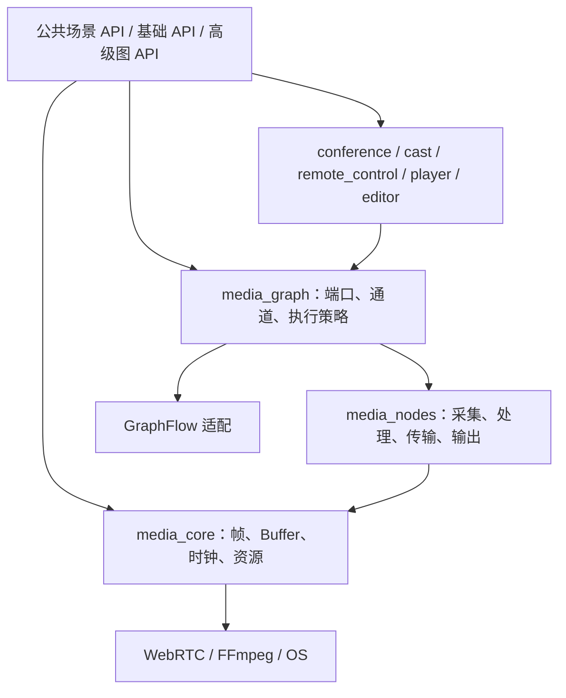

# livekit-sdk-cpp 仓库设计

版本：v0.1；日期：2026-10-26；状态：现有实现说明 + 演进设计；读取基线：`2cfd118`。

平台定位见 [总体设计](../../docs/architecture/platform-design.md)，统一媒体层的详细契约见 [SDK 架构设计](../../docs/architecture/sdk-architecture.md)。本文说明现有代码如何向该架构演进，不将目标类型视为已发布 API。

## 1. 职责与现状

当前 SDK 是直接链接 libwebrtc 的 C++20 库，公开命名空间为 `livekit::sdk`，CMake target 为 `LiveKit::SDK`。提供 Room、Participant、TrackPublication、动态发布订阅、数据通道、状态快照、统计、I420 回调，以及可信后端使用的 Token 与管理 API 客户端。

当前源码级集成已在 Windows x64 验证；Linux preset 不等于 SDK Linux 已验收。文件/FFmpeg 网络输入解码后由 WebRTC 编码发送；每轨 WAV/Y4M 录制不等于同步 MP4 或云录制。六类管理客户端、49 个 RPC 存在，不等于本项目媒体服务实现所有对应后端。

当前已接入首版媒体图、播放器、采集和远控。尚缺完整设备管理、通用自定义媒体输入、时间线编辑、自动重连及跨平台分发；具体范围见播放器、媒体图和远控实现说明。

## 2. 当前代码分工

| 目录/文件 | 角色 |
| --- | --- |
| `include/livekit/room.hpp`、`participant.hpp` | 会话与参与者/轨道公共 API |
| `include/livekit/media.hpp` | 当前媒体输入描述与帧相关接口 |
| `src/engines/rtc/room.cpp`、`sdk.cpp`、`participant.cpp`、`room_events.cpp` | 会话、命令、对象状态与事件 |
| `src/engines/rtc/media.cpp`、`video_frames.cpp`、`video_playout*.cpp` | 媒体输入、帧回调与可选窗口输出 |
| `src/server_sdk/auth.cpp`、`api.cpp`、`services.cpp`、`room_service.cpp` | Token 和服务端管理客户端 |
| 各 `src/` 模块内的 `.hpp` | 私有头与实现共置 |
| `protocol/`、`cmake/` | 信令兼容子集、原生依赖和构建 |
| `tools/cli/`、`examples/`、`tests/consumer/` | 公共 API 消费者与集成验证 |

公共头文件不泄露 WebRTC、Protobuf、SDL、GraphFlow 类型。客户端应用只消费公开接口；CLI 的信号处理、stdout JSON 和命令参数不进入 SDK 内核。

## 3. 目标分层与构建边界

`LiveKit::MediaCore`、`LiveKit::MediaGraph`、`LiveKit::MediaNodesWebRTC`、`LiveKit::Player`、`LiveKit::ServerSDK` 已有构建目标。RTC 图由独立私有目标 `livekit_rtc_graph` 管理；Player-only 不链接 RTC，ServerSDK-only 不引入媒体依赖。CLI、示例和产品 APP 分别由自己的入口构建。

播放器不因公共依赖引入完整 RTC，会议也不因统一 SDK 引入剪辑器。FFmpeg 按播放、编码、封装需求分别接入；当前外部进程输入方式与未来库级后端明确区分。具体静态/动态链接及许可证要求在打包时确认。

## 4. API 与所有权

| API 层 | 目标对象 | 规则 |
| --- | --- | --- |
| 场景 | ConferenceSession、CastSession、RemoteControlSession、Player、EditProject、ExportJob | 场景内部图由场景引擎独占管理 |
| 基础 | Runtime、MediaSource、MediaSink、设备/能力查询 | Runtime 管理资源租约，允许多实例 |
| 高级图 | MediaGraph、MediaNode、端口与连接描述 | 调用者管理独立图，不直接修改场景内部图 |

所有帧和包携带时间基、时间戳、流代次与明确的 Buffer 所有权。共享帧默认只读，修改产生新输出或写时复制；GPU 资源携带设备/上下文与同步规则，不承诺任意后端零拷贝。

RTC PublishedTrack 与剪辑 TimelineTrack 分开建模。运行时中设备通过引用计数/租约共享，关闭一张图不能关闭其他图仍使用的设备。麦克风、播放和 AEC 参考音频由统一音频资源管理，避免多个独立回声处理环路。

## 5. 现有线程契约与演进

现有 `join*()` 由 Room 后台会话线程运行；`run()` 在调用线程阻塞。所有回调包括视频帧在会话线程串行分发；回调执行时不持有 SDK 状态锁，但慢回调仍会拖延会话处理。回调内不能等待同一个 Room 未完成的 future，可提交命令或 request_stop。

应用串行调用 join/disconnect/wait；disconnect 等待自有线程，wait 可抛出后台错误。旧 Participant/Publication 句柄在重新入会后失效。发布轨道 future 等待服务端确认；订阅/metadata/settings future 目前只确认信令已发送；数据发送完成也不等于对端已处理。上层必须保持这些差异。

目标引入可指定的控制事件执行器与独立有界媒体输出队列，不改变后端 network/worker/signaling 线程归属。音频设备回调走非阻塞路径，禁止分配大块内存、磁盘 I/O 或等待 UI。每个节点不固定创建专用线程。

## 6. 媒体图与调度

GraphFlow EventBus 承载启动、停止、参数、错误与完成等控制事件；独立 MediaChannel 承载帧句柄。图准备期校验拓扑、类型、格式、内存位置和时钟；格式转换必须显式或由可检查的构图规则插入。

| 模式 | 驱动 | 缓冲与过载 |
| --- | --- | --- |
| Realtime | 采集/网络推送 | 有界队列，允许丢弃过期视频；音频按连续性处理 |
| Playback | 播放时钟 | 预缓冲、音视频同步、暂停/Seek 与代次切换 |
| Preview | 指定时间点请求 | 缓存、取消旧请求，仅保留最新预览需求 |
| Offline | 导出任务拉动 | 背压、完整时间线、可取消，不以实时丢帧策略导出 |

分支各自设队列与过载策略，共享只读 Buffer。预览和网络发送不能因录制分支慢而无限积压；录制达到资源上限时按配置降载、报告丢帧或失败，不隐式阻塞实时分支。

图状态拟定 Created/Prepared/Running/Stopping/Stopped/Failed/Released。准备先让下游就绪，再激活源；停止区分 cancel 与 drain，文件输出需排空编码器和结束封装。Seek、重连、切换输入提升 generation，清理旧缓存并拒绝旧帧。第一版动态改图允许有间断重建，不承诺无缝热切换。

## 7. 场景组合

- 会议：成员状态 + 音视频源 + RTC 发布订阅 + 输出；屏幕共享复用屏幕源。
- 传屏：屏幕源同时连接预览、RTC 和可选录制分支，系统音频单独查询能力。
- 远控：传屏 + 可靠控制协议 + 授权/同意 + 系统输入；可靠按键和可合并鼠标移动分开处理。
- 播放器：源/解封装/解码 + 媒体时钟 + 输出；Seek 后拒绝旧代次数据。
- 剪辑：素材/片段/轨道/转场描述转换为时间请求与媒体图；预览和导出复用同一时间线语义。

远控授权由业务服务签发，被控端 SDK 校验并执行，断线/撤权/过期必须释放键和按钮。普通数据通道不直接提供“允许控制”的语义。远控对象为目标设计，当前未交付。

## 8. 错误、统计与兼容

目标统一错误包含 domain/code、操作、是否可重试、session/graph/node/stream ID 与原始后端原因；不能只返回布尔值。资源准备失败按反向顺序回滚，关闭操作幂等，定义关闭完成后不再投递回调。

当前 RTCStats 是可选事件，采样间隔 200–60000 ms，默认关闭，每连接最多一个请求在途。未来增加队列深度、丢帧原因、图耗时和设备状态；采样不阻塞媒体线程。质量指标保留输入/编码/转发/解码/呈现的口径差异。

SDK 以源码集成为当前交付形式；稳定跨语言分发采用版本化 C ABI，明确句柄、内存释放、回调、取消和错误。Web 端通过浏览器后端实现相近产品语义，能力矩阵显式表达差异，不强行复用原生二进制。

## 9. 演进与验证

1. 保持现有 API，优先关闭与本项目媒体服务的文件四轨和跨系统失败。
2. 抽出帧/Buffer/时钟与设备契约，补真实设备和自定义输入，保留公共头文件隔离。
3. 接入 GraphFlow 适配与 MediaChannel，完成采集→预览/发布闭环和慢消费者隔离。
4. 分离 server_sdk 构建边界，增加场景与可选节点目标。
5. 实现播放器、剪辑、远控及版本化绑定，按平台验收后发布。

验证入口沿用 [README](../README.md)与 [VALIDATION](../VALIDATION.md)：单测、独立消费者、SDK/CLI 实际媒体集成。新增架构需覆盖队列过载、停止排空、取消、旧代次丢弃、共享设备、快速 Seek 和回调异常。当前 [RTC 交接快照](../../docs/integration/rtc/STATUS_AND_HANDOFF.md)记录的失败优先于历史通过；本次只编写设计，没有重跑媒体验收。
