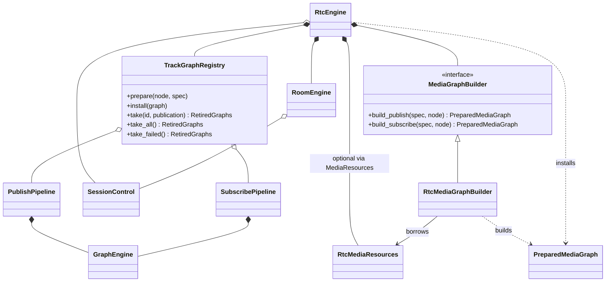

# RTC 引擎解耦（2026-10-30）

此次重构保持 `RtcEngine`、`RtcGraphApi` 和 `examples/conference_viewer` 的调用接口，继续使用每轨独立的 GraphEngine。

原有 `RtcMediaEngine → RtcPipelineEngine → RoomEngine` 的调用链拆为 RtcEngine 统一编排三个平级模块：



## 模块边界

| 模块 | 负责 | 依赖边界 |
| --- | --- | --- |
| RtcEngine | 创建端点、调用构图、启动和注册、回滚、停止及解绑 | 唯一跨模块编排者 |
| RoomEngine | 会话、信令、传输、端点状态和原生解绑 | 不管理媒体图 |
| TrackGraphRegistry | 每轨图准备、启动、索引、失败收集、停止 | 不持有或调用 RoomEngine；接收每轨 RTC 节点及 TrackGraphSpec |
| MediaGraphBuilder / RtcMediaGraphBuilder | 采集、编解码、同步、播放、录制节点及连接 | 不持有或调用注册表和 RoomEngine；返回未启动的 PreparedMediaGraph |
| RtcMediaResources | 音频输出会话、回声参考、共享同步时钟 | 由 RtcEngine 持有，构图器借用 |
| SessionControl | 控制发起互斥、按轨道异步调度及终止状态 | 独立共享对象，房间和门面共享；独立 RoomEngine 创建自己的上下文 |

`track_endpoint.hpp` 提供 PublishedTrack / SubscribedTrack 端口。RTC 节点不再为了使用端口包含整个 `room_engine.hpp`。`track_graph.hpp` 提供构图数据，不包含 Pipeline 或 RtcEngine 的声明。

可选媒体代码分为两个链接目标：`livekit_rtc_media_graphs` 只链接节点、GraphFlow 和媒体能力；原有 `LiveKit::RTCMediaEngine` 保留为组合入口，链接核心引擎和构图模块。`media_assembly.cpp` 安装资源与构图器，构图器实现不再包含 `rtc_engine_impl.hpp`。

## 生命周期与失败

发布、订阅均由门面依次执行：确认端点 → 构造节点与图描述 → 初始化并启动图 → 注册。构图或启动失败时，门面保留图及端点引用，静止工作线程、停止图、等待端点解绑，然后返回携带轨道上下文的错误。

注册表的 `take` / `take_all` / `take_failed` 先停止图，返回仍持有 Pipeline 的 `RetiredGraphs`。门面在原生解绑完成前保留该对象，因此节点和图资源不会在解绑仍进行时提前析构。一个轨道的删除不会停止兄弟轨道。

由注册表创建的 Pipeline 只管理图生命周期。公开的独立 PublishPipeline / SubscribePipeline 构造函数保持原有语义：`close()` 同时关闭其端点。quiesce 钩子在部分启动失败和重复关闭时只调用一次，失败通知也只交付一次。

运行中的媒体错误通过端点故障通道报告给房间传输层，并通知应用；传输自身故障也可以先使端点终止。后续 observer 异步控制实现中，图故障及端点终止会自动请求控制 worker 回收图，不再依赖下一次应用控制调用。请求合并到一个独立调度位，在当前操作完成后处理，leave/close 优先；仍须等待原生解绑后才能释放图资源。失败收集继续比较端点对象身份，防止旧端点的迟到报告删除同 ID 的新图。详见 [observer 异步控制](rtc-observers.md)。

## 验证

新增测试覆盖：注册表不隐式解绑端点、图资源保留到异步解绑完成、发布和订阅初始化失败回滚、工厂失败、失败 ID 复用、重新入会、构图器不依赖注册表实例且不自动启动。源码依赖边界检查防止两个底层模块重新包含房间或门面实现头文件。

后端独立配置 Release 已编译通过，CTest 5/5 通过：`result`、`async_result`、`rtc_backend`、`rtc_pipelines`、`rtc_dependency_boundaries`。

完整 `out/windows-x64` Release 配置编译通过，包括 `livekit_conference_demo`、独立 `livekit_rtc_media_graphs` 及全部相关测试程序。CTest **27/27 通过**，覆盖 `rtc_architecture`、`rtc_media_engine`、`ffmpeg_rtc_codecs`、`demo_render` 等；本次未修改会议示例的调用代码。

隔离本地 SFU 集成回归通过：生成音视频的编码/解码、实际 RTP 数据、音视频录制、SDL dummy 播放、多轨会议增删与关闭，以及 UDP/TCP 下的按需暂停和恢复。报告位于聚合仓库 `out/rtc-refactor-integration/20261030-095506/result.json`，服务进程由测试脚本创建并在结束时清理。

集成回归首次运行暴露了测试脚本的旧拓扑断言：它要求解码器直接连接输出，而重构前已经存在 `presentation.clock` 同步节点。脚本现检查同一轨道快照中的同类型边，允许经过这一明确的同步节点，不接受任意中间路径；修改后完整集成回归通过。另外为原有 `async_result_tests.cpp` 补上缺失的 `<chrono>` 直接包含。

从聚合仓库根目录执行的主要命令：

```powershell
cmake --build livekit-sdk-cpp/out/rtc-backend-contracts --config Release --parallel 6
ctest --test-dir livekit-sdk-cpp/out/rtc-backend-contracts -C Release --output-on-failure
cmake --build livekit-sdk-cpp/out/windows-x64 --config Release --parallel 6
ctest --test-dir livekit-sdk-cpp/out/windows-x64 -C Release --output-on-failure
python livekit-sdk-cpp/tests/media_graph_integration.py --lk livekit-sdk-cpp/out/windows-x64/Release/lk.exe --server out/demo-dynacast/livekit-server.exe --demo-client livekit-sdk-cpp/out/windows-x64/Release/livekit_demo_integration.exe --demo-demand-client livekit-sdk-cpp/out/windows-x64/Release/livekit_demo_dynacast_integration.exe --headless-video --output out/rtc-refactor-integration
```

构建与测试日志位于聚合仓库 `out/rtc-refactor-{backend,full}-{build,tests}.log` 和 `out/rtc-refactor-integration.log`。完整构建仍有第三方及存量代码警告，没有编译错误。验证使用编译、自动化测试和无窗口渲染；不代表真实摄像头、麦克风或扬声器已完成人工验收。

聚合仓库的 `docs/architecture/sdk-class-diagrams/` 已同步总体图和受影响模块图。

## 后续按轨道调度进展（2026-10-30）

RoomEngine 已将协议发起与结果等待分离：共享待完成对象由后台状态机结算，控制队列可
调度其它轨道；同轨操作及房间 join/leave/close 保持顺序屏障。同步端点控制仅在发起时
持有控制互斥锁，原生解绑支持多个等待者。结果交付继续使用独立 observer 通知线程。

RtcEngine 的图构造、回滚、失败图回收和编解码策略仍使用同步适配器，尚待迁移。
此处记录的是分阶段进展，完整跨轨并发目标仍未完成。验证与约束见
[observer 异步控制](rtc-observers.md)。

## 单次完成回调迁移（2026-10-30）

后续接口已统一为每次调用传入 Completion<T>，Observer 只接收持续事件。RtcEngine 的普通发布/订阅
端点等待与建图已分阶段执行，解绑期间保留图资源并让出控制调度，媒体启停和自动维护运行于生命周期
序列。编解码策略事务及失败回滚仍在该生命周期序列串行执行。当前契约与本次验证见
[Completion/Observer](rtc-observers.md) 和 [重构记录](rtc-completion-refactor-20261030.md)。
